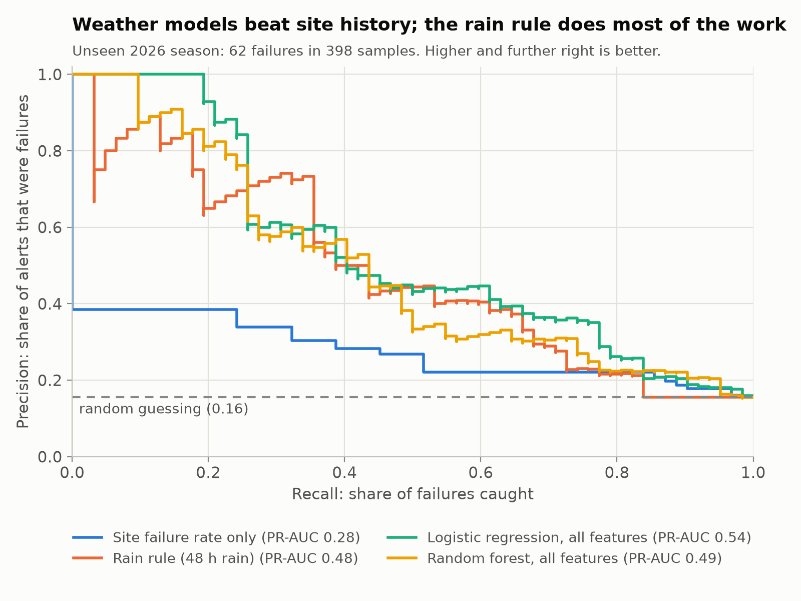
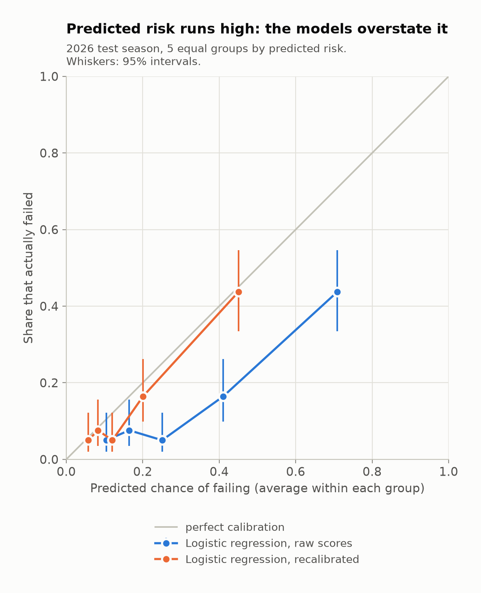
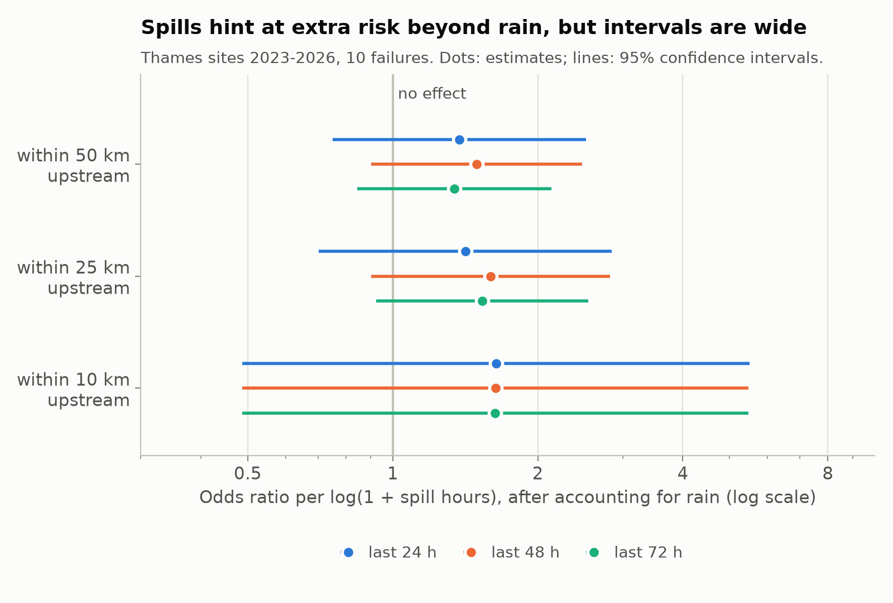

# Detailed results

The full results behind the summary in the [README](README.md). Every data and modelling choice is explained in [DATA_DECISIONS.md](DATA_DECISIONS.md).

## Main model: all 20 sites, tested on the unseen 2026 season

Trained on 2021–2025 (664 samples), tested on 2026 (398 samples, 62 failures). Decision thresholds were chosen on the training data only, using leave-one-season-out predictions (each training season predicted by a model that never saw it).

| Model | PR-AUC (95% range) | ROC-AUC | Failures caught | Samples flagged | Precision |
| --- | --- | --- | --- | --- | --- |
| Random guessing | 0.16 | 0.50 | | | |
| Site failure rate only | 0.28 (0.20–0.37) | 0.70 | 60 of 62 | 338 | 18% |
| Rain rule (> 2.7 mm in 48 h) | 0.48 (0.36–0.61) | 0.75 | 40 of 62 | 107 | 37% |
| Logistic regression, rain + season | 0.51 (0.39–0.63) | 0.76 | 33 of 62 | 73 | 45% |
| Logistic regression, all features | 0.54 (0.42–0.65) | 0.79 | 29 of 62 | 64 | 45% |
| Random forest, all features | 0.49 (0.37–0.61) | 0.76 | 34 of 62 | 102 | 33% |
| Gradient boosting, all features (rain can only raise risk) | 0.43 (0.32–0.55) | 0.71 | 25 of 62 | 74 | 34% |
| Logistic regression, all + low flow, temperature, sunlight | 0.53 (0.41–0.65) | 0.78 | 31 of 62 | 67 | 46% |
| Logistic regression, all + previous result, 14-day rain | 0.47 (0.36–0.59) | 0.81 | 26 of 62 | 54 | 48% |
| **Two-part rule: rain rule OR last known result failed** | | | **48 of 62** | 146 | 33% |

Compared with the rain rule on the same 1,000 test resamples (paired bootstrap), every model's difference in PR-AUC has a 95% range that includes zero. The full logistic regression comes closest: +0.05 (−0.02 to +0.13), better in 90% of resamples.

The logistic regression's small edge comes from knowing each site's history: PR-AUC 0.58 vs 0.50 for the rain rule on familiar sites, but the same (0.46) on the 6 sites first sampled in 2026. Random forests and gradient boosting, usually the strongest methods for tabular data, did worse than logistic regression: with about 180 training failures, more flexible models have more room to fit noise. The features that matter most are relative river flow, rain in the last 6 h and 48 h, time of year and site history.

## Calibration and error analysis

- **Raw scores overstate risk about twice over.** The logistic regression predicted an average 33% chance of failing; 16% failed. Balanced class weights inflate the scores, and 2026 was a cleaner year than the training years. A logistic recalibration fitted on the training years brings the average to 18% and improves the Brier score from 0.143 to 0.103; in the riskiest fifth of samples it predicts 44% and 44% failed. The ranking, and so PR-AUC, is unchanged.
- **About a quarter of failures follow dry weather.** 17 of 62 failures came after less than 0.5 mm of rain in 48 hours; no weather model caught any of them. Of the 19 failures missed by all four weather models, 84% followed a dry 48 hours and 6 were at the River Tone in Taunton. Several came after a wet week (12–21 mm over 7 days) or at very low flow (0.1–0.5× normal), which hints at slow catchment drainage or less dilution of steady sources such as treated effluent.
- **On new sites, use the rain rule.** It caught 11 of 21 failures at the six sites first sampled in 2026; the full logistic regression caught 6, because it leans on site history that new sites don't have.
- **Marginal failures are hardest:** 32% of failures at 1–2× the limit were caught, against 64% at more than 5×.
- **False alarms are often near misses:** 35 of the model's 64 alerts didn't fail, but 54% of those were at least half the limit.

## Chasing the dry-weather failures

Sunlight kills faecal bacteria (UV damages their DNA), warmth changes how long they survive, and at low flow steady sources such as treated effluent are less diluted. So I added hourly temperature and sunlight for each site (Open-Meteo) and a low-flow feature, aimed at the dry-weather failures.

On their own they look promising: samples after the sunniest quarter of days fail 13% of the time against 35% after the dullest. But sunny days are mostly dry days, so most of that is rain again. Added to the full logistic regression they change PR-AUC by −0.007 (−0.05 to +0.04), better in only 37% of resamples, and still catch **0 of the 17 dry-weather failures**. The model does use them (shuffling low flow or the 7-day temperature lowers its score), but they replace information it already had from flow and rain rather than adding new information. The dry-weather failures probably need data these sources don't have, such as treated-effluent discharges, livestock or birds near the site, or the many unmonitored overflows outside Thames Water's area.

**What did help: the site's last result.** Pollution at a site tends to last: on dry days, samples taken after a failed result failed 31% of the time, against 5% after a result under half the limit. Only results at least 2 days old are used, since that is how long the lab takes. Given to the logistic regression as a feature, this made the best training score (cross-validated PR-AUC 0.70) but a worse 2026 score (−0.06, better in 7% of resamples): a reminder that a better training score need not carry over to a new season. Used instead as a second trigger alongside the rain rule, with nothing new to tune, it works in both periods. One caveat: I only went looking for this after studying the 2026 misses, so the 2026 rows below are not a clean test. The 2021–2025 rows are the fairer evidence, since nothing was fitted to them either.

| Rule | Period | Flagged | Failures caught | Precision | Dry-weather failures caught |
| --- | --- | --- | --- | --- | --- |
| Rain > 2.7 mm in 48 h | 2021–2025 | 215 | 106 of 177 | 49% | 0 of 37 |
| Rain rule OR last result failed | 2021–2025 | 313 | 145 of 177 | 46% | 19 of 37 |
| Rain > 2.7 mm in 48 h | 2026 | 107 | 40 of 62 | 37% | 0 of 17 |
| Rain rule OR last result failed | 2026 | 146 | 48 of 62 | 33% | 6 of 17 |

In 2026 the extra 39 alerts caught 8 more failures (21% of them failed, above the 16% base rate). For a swimmer that is the better trade: a missed failure is worse than an unnecessary warning. It is also how a live service could work, since both inputs are known on the morning of a swim.

## Choosing the alert threshold

The thresholds above maximise F1, which treats a missed failure and a false alarm as equally bad. For a swimmer they aren't: a missed failure means swimming in polluted water, while a false alarm means skipping a swim that would have been fine. So every model was also run at a high-recall threshold: the highest one that catches 80% of failures in 2021–2025, again set on training data only.

| Rule (2026 test season) | Alert when | Flagged | Failures caught | Precision |
| --- | --- | --- | --- | --- |
| Rain rule, balanced | > 2.7 mm in 48 h | 107 | 40 of 62 | 37% |
| Rain rule, high-recall | > 0.5 mm in 48 h | 176 | 45 of 62 | 26% |
| Logistic regression (all features), high-recall | score > 0.39 | 130 | 46 of 62 | 35% |
| Two-part rule, balanced | > 2.7 mm OR last result failed | 146 | 48 of 62 | 33% |
| Two-part rule, high-recall | > 0.5 mm OR last result failed | 203 | 51 of 62 | 25% |

- **Rain alone can't reach 80% in 2026.** The 0.5 mm rule catches all 45 failures that followed rain and none of the 17 that followed dry weather. Every weather model lands at 73–77% recall.
- **At high recall the logistic regression pays off:** one more failure caught than the rain rule (46 vs 45) with 46 fewer alerts.
- **Lowering the rain threshold within the two-part rule isn't worth it.** In 2026 it adds 57 alerts to catch 3 more failures; only 5% of those extra alerts failed, below the 16% base rate. In 2021–2025: 123 extra alerts, 12% failed, against a 27% base rate. Adding the last result did the opposite: its extra alerts failed more often than average.

So the recall-first choice is the two-part rule at the balanced rain threshold: 48 of 62 failures caught (77%) from 146 alerts. Going further mostly adds warnings on days that were safer than average.

## Predicting the bacteria count

The models above learn from pass/fail only, so a sample at 900 E. coli counts the same as one at 20. To use every sample's actual count, two linear regressions were fitted on exactly the full logistic regression's features, and each one's prediction became a failure score (`scripts/13_ecoli_regression.py`):

- **E. coli:** log10 E. coli.
- **Furthest over the limit:** log10 of the larger of E. coli/1000 and enterococci/400, so above 0 means a fail. This one also sees the 15 of 62 failures in 2026 that were on enterococci alone.

| 2026 test season | E. coli | Furthest over the limit |
| --- | --- | --- |
| PR-AUC for failures (logistic regression 0.54, rain rule 0.48) | 0.53 (0.40–0.65) | 0.53 (0.41–0.65) |
| Paired difference vs logistic regression | −0.011 (−0.057 to +0.031) | −0.005 (−0.040 to +0.028) |
| Paired difference vs rain rule | +0.040 (−0.042 to +0.119) | +0.046 (−0.030 to +0.122) |
| Count itself: R² (training-average baseline) | 0.24 (−0.21) | 0.27 (−0.16) |
| Typical error | factor of 1.8 | factor of 1.9 |
| Alert if prediction is over the limit | 31 alerts, 22 real (71%); 22 of 62 caught | 49 alerts, 28 real (57%); 28 of 62 caught |

Every paired difference has a 95% range that includes zero. The counts didn't improve the ranking, even with enterococci included: both regressions rank 2026 samples no better than the pass/fail model. The baselines below zero show that 2026 counts ran lower than in 2021–2025. That makes the counts themselves harder to predict, but PR-AUC depends only on the order of the scores, not their level. A predicted value over the limit is a fairly precise warning but misses over half the failures, so at best it could mark a 'very likely unsafe' level on top of the two-part rule.

## Spills experiment: 4 Thames sites, 2023–2026

179 samples, 10 failures. With so few failures, comparing prediction scores would be close to meaningless, so the question was asked statistically: does adding upstream spill hours improve a model that already knows rain?

| Check | Result |
| --- | --- |
| Within similar rain | Light rain (0.5–4 mm): 2 of 4 failed after a spill vs 1 of 35 without. Wet (> 4 mm): 2 of 11 vs 3 of 24 |
| Likelihood-ratio test, spills added to a rain model | Odds ratio 1.60 per log(1 + spill hours), 95% CI 0.90–2.83, p = 0.13 |
| Permutation test (spills shuffled within site and rain group) | p = 0.056 |
| Same test with river flow also in the model | Odds ratio 2.37, 95% CI 1.23–4.56, p = 0.015 (one of two models tried, so supporting evidence only) |
| Spill hours divided by river flow, same permutation test | p = 0.50: weaker than spill hours alone |
| Cross-validated PR-AUC | Rain only 0.39; rain + spills 0.35 |

In plain terms: under the rain model, a sample taken after 6 hours of upstream spilling has about 2.5 times the odds of failing, but the plausible range runs from no effect to about 7 times. The signal is strongest for spills 25–50 km upstream over the previous 48–72 hours, which fits river travel times of very roughly 25 km a day. Within 10 km it is weakest, because only 1–4 overflows sit that close to each site. Dividing spill hours by river flow, so that a spill counts for less in a fuller river, made the signal weaker rather than stronger; flow works better as a separate term in the model. More seasons of data would settle the question.
